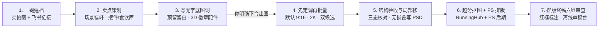

# DUMIK Design Plugins

面向 DUMIK 视觉与电商设计团队的 AI 协同工作流插件，支持 **Antigravity（反重力）**、**Codex** 与 **ZCode**。

它不是零散的抽卡工具，而是把 **「建档 → 策划与摆件/食饮排期 → 写词与 3D 徽章配件 → 授权出图 → 结构验收与局部修复 → 超分抠图与 PS 排版 → 排版终稿六维审查」** 串成一套可控的项目制生产线，同时把设计师日常高频的改图、食饮造型、徽章清洗、反推、拉片、分镜与终稿审校封装成开箱即用的工具。

- **最新版本与更新公告**：统一发布在 [GitHub Releases](https://github.com/Hill2048/dumik-design-plugins/releases)

---

## 一、这套工具能帮你干嘛？

### 1. 跑通整套「一产品一文件夹」项目制工作流

面对一整套主图 + 详情页需求，你不需要反复向 AI 解释产品长什么样、之前定了什么风格，也不用担心目录里堆满临时垃圾，从前期建档到上线前终稿审字全链路闭环：

- **一文件夹四文档管到底，开新对话不用重讲**：把产品实拍图、白底图和飞书画布链接丢进项目文件夹，自动整理素材并生成四文档架构（`AGENTS.md` 仅自动内联纯视觉宪法 `design.md` 防上下文截断，资产路径/哈希/摆件库/食材表落 `assets.md`，分屏进度总账落 `project.md`）。飞书改稿支持 `--sync` 一键增量同步，不覆盖已定调或已定稿画面。
- **先定调、建置景与食饮表，再分批出图**：先跑视觉里程碑锁定全案调性，再延伸 8~12 件风格摆件库与全案饮品/食材错峰排期，避免跨屏撞景撞摆件；随后按主图共用核心屏优先推进，批量临时文件全在系统 `%TEMP%` 完成，项目文件夹零垃圾、全中文命名。
- **先看方案和提示词，绝不私自花钱生图**：默认只交付策划和提示词；只有你本轮明确说出「开始生图 / 出图 / 跑图」后，才会调用 DesignFlow 画布或生图接口。
- **只出纯无字底图 + 三层参考隔离**：AI 专注光影、材质、结构和氛围，不渲染营销文案、标尺和乱码角标（仅保留产品原生丝印/刻字）并预留 PS 排版区；带 UI/水印的飞书截图与未定稿候选图严禁垫图；凡画面出现任何人物（哪怕只露手、腕或肩背），强制绑定人物身份卡保持统一。
- **上线前排版终稿六维审查把关**：设计师在 PS 排完详情长图或主图后，自动带坐标标尺高清切片读字，逐屏对照飞书策划原图、规格真源与广告法合规红线（违禁/极限词一律标红），生成红框编号标注大图与单文件离线 HTML 审稿台落入 `成品/审稿报告/`。

### 2. 覆盖设计师日常高频的各类视觉能力

除了整套详情页项目，日常零散需求也能直接调用：

| 设计场景 | 你能直接用它做什么 |
| --- | --- |
| **电商主图与日常改图** | 换背景、换材质、调光影、四宫格创意方向发散、线稿/色块高清重绘；支持单图、多候选与跨模型并发出图 |
| **食饮造型与锅具配菜** | 基于 1000+ 实拍精析与内置 31 张 3×3 高清垫图板（共 279 张无水印参考、单格 1024px 一键拆图），专注饮品/食材/锅具王牌配菜的选品排期、造型结构与微观口感物理，不与场景光影打架 |
| **品牌 3D 徽章与旧标清洗** | 支持新建 DUMIK 专属扁六边形 3D 徽章（内置三材质四层标杆库）及保留原外形的旧认证标/图标两步脱壳清洗；先出纯色 2D 平面逐字确认再渲染纯白底 3D 成品，并按全案/单屏分层归档 |
| **结构验收与局部无损修复** | 对照白底原图输出三态结构与无字纯净度审稿；发现把手、Logo、接缝、晶粒等局部漂移时，自动外扩切图 + 白底局部对齐 + 强制回原始干净图防变红变糊，原地覆写唯一修复图与可编辑 PSD |
| **排版终稿六维审查** | 查错字、老模板残留、数据打架、漏填项与违禁合规词（合规问题一律红灯）；输出居中连贯 0 缝详情长图 + 左右悬浮卡片细线引导 + 放大策划原图对照 + 右上角缩略图导航 + 可拖选一键复制正确文案的离线 HTML 审稿台 |
| **参考图反推提示词** | 遇到好参考图时，先把构图、光影和主体结构拆成可编辑草稿，由你定好主次与锁定区，再编译成可直接复用的终稿提示词 |
| **放大超分与一键抠图** | 选中的候选图可直接调用 RunningHub 做高清超分放大、抠图与去背景 |
| **短视频策划、拉片与出片** | 拆解竞品或真实参考视频并生成可视化拉片报告；梳理卖点节奏与开头钩子、编写分镜故事板与关键帧提示词；确认后直接提交 Seedance、Dreamina 或 Veo 生成并下载成片 |
| **API 基准测试** | 新增或更换生图 API 时，用标准双参考改图题快速测速、尺寸比例与保真度（注：原 Photoshop PSB 智能对象插件已废弃归档，默认不再加载与拉取） |

---

## 二、设计师怎么开口就能用？

安装完成后，不需要背诵任何命令或英文名，直接按真实工作意图说话即可：

- **新开产品项目**：「用这个飞书链接初始化当前项目文件夹，整理实拍图并生成策划表」
- **飞书改稿同步**：「同步一下飞书画布的最新修改」
- **规划摆件与食饮**：「先帮我出全案的风格摆件库和饮品食材错峰表，从图板里挑几张参考」
- **只写词不出图**：「先帮我写 S01 和 S02 的纯无字底图提示词」
- **做 3D 徽章 / 洗旧标**：「帮我把这几个卖点做成 DUMIK 扁六边形 3D 徽章，先出 2D 平面核对文字」
- **确认开始出图**：「提示词没问题，开始生图，按默认 9:16 2K 跑 2 张候选」
- **验收与局部修**：「对照白底原图验收一下结构漂没漂，顺便把这张的把手局部修一下」
- **审查排版终稿**：「对比飞书策划和规格表，审查一遍这两张排版终稿，在图上圈出来生成审稿台」
- **放大 / 抠图**：「把这张定稿图用 RunningHub 放大到 4K / 抠出透明底」
- **做短视频**：「帮我拉片分析这条视频，然后给我们的产品写一版 15 秒分镜」

---

## 三、安装与接入（三端支持）

### 1. Antigravity（反重力）

支持通过插件配置或本地挂载将本仓库的 `plugins/dumik-team-plugin` 接入 `~/.gemini/config/plugins/dumik`：

- 接入后自动启用团队全局视觉规则、生命周期护航钩子（`hooks.json`）与全部 14 个工作流技能。
- 配合 DesignFlow MCP 使用时，生图任务默认直接走画布节点流（默认规格 `Banana 2.1 · 9:16 · 2K · x2`，支持同词多模型/多屏单节点并发，离线或冲突时自动直连兜底）。

### 2. Codex

在 Codex 中打开「添加插件市场」：

- **来源**：`https://github.com/Hill2048/dumik-design-plugins`
- **Git 引用**：`main`
- **稀疏路径**：留空

### 3. ZCode

在 ZCode 中添加插件市场，来源填写：

- `Hill2048/dumik-design-plugins`（或 `https://github.com/Hill2048/dumik-design-plugins`）

安装后搜索 `DUMIK Team Plugin` 即可启用。

---

## 四、给维护者的技术索引

> 日常使用无需关心以下细节，仅在维护插件、配置本机接口或发版时查阅。

- **底层能力模块（14 个活跃 Skills）**：项目建档 `d-init` · 视觉策划 `d-visual-plan` · 图片导演 `d-image-director`（含摆件材质库与 4 张 3×3 高清摆件图板）· 食饮与锅具造型师 `d-food-drink-stylist`（含 27 张 3×3 高清食饮垫图板与 `crop_moodboard_tile.py` 一键拆 1024px 单格）· 品牌扁六边形 3D 徽章 `d-brand-badge`（内置 4 张品牌标牌与三材质四层标杆图库）· 徽章材质清洗 `d-badge-wash` · 图片执行 `d-image-runner`（支持 DesignFlow / DSH 画布与 API 直连）· 批量流水线 `d-project-pipeline` · 一致性审稿 `d-consistency-check` · 终稿排版审查 `d-detail-review`（带坐标标尺切片 `slice_for_review.py` + 悬浮连线离线审稿台 `build_review_board.py`）· 参考图反推 `d-prompt-reverse` · 视频导演 `d-video-director` · 视频执行 `d-video-runner` · API 基准测试 `d-api-test`（详细路由见 [agent-skill-routing.md](plugins/dumik-team-plugin/assets/agent-skill-routing.md)，端到端 8 阶段生产线见 [workflow-chain.md](plugins/dumik-team-plugin/assets/workflow-chain.md)）。原 `d-psb-install`（PSB 智能对象工具）已标注废弃并移入 `archive/deprecated-psb-tools/` 保留存档，默认不再加载也不自动拉取。
- **统一字体与 UI 规范**：全插件所有 HTML 审稿台、可视化报告、工具面板与脚本图片标注统一采用中文 `MiSans`（`MiSans VF`）、英文与数字 `Google Sans`（`Google Sans Flex`）。
- **项目协议与钩子护航**：四文档防截断结构与标准目录定义见 [project-env-protocol.md](plugins/dumik-team-plugin/assets/project-env-protocol.md)；生命周期路由、防漂移、垃圾拦截与长会话提醒由 `plugins/dumik-team-plugin/hooks/agy_dumik_hooks.py` 统一驱动。
- **密钥隔离**：公开仓库不内置任何 API Key。直连生图前请在本机配置环境变量，或运行 `scripts/init_api_cache.py` 写入本机缓存，或通过 `--api-key` 临时传入。
- **自动更新**：支持会话级快进更新检查（`scripts/update_dumik_plugin.ps1`），自动保护本地未提交改动，并已兼容旧仓库名 `dumik-codex-plugins` 的自动迁移。
- **发版规则**：见 [rules/AGENTS.md](plugins/dumik-team-plugin/rules/AGENTS.md)。日常修改仅本地保存测试，严禁私自推送；仅在明确发版指令下通过 `plugins/dumik-team-plugin/scripts/release_dumik_plugin.ps1 -NotesFile "<公告文件>"` 递增版本号（默认 `+0.0.1`）并同步发布至 GitHub Releases。
