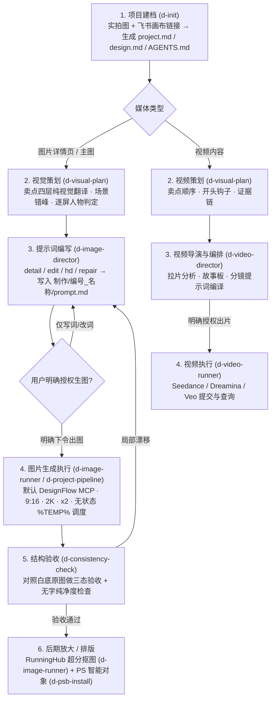

# DUMIK Design 插件市场

DUMIK 团队共用的电商视觉与视频工作流插件仓库，同时兼容 Codex、ZCode 与 Antigravity。

- **插件名**：`dumik-team-plugin`（DUMIK Team Plugin）
- **当前版本**：见 [plugin.json](plugins/dumik-team-plugin/.codex-plugin/plugin.json) 与 [skill-versions.json](plugins/dumik-team-plugin/assets/skill-versions.json)
- **更新公告**：全部正式版本与变更说明统一发布在 [GitHub Releases](https://github.com/Hill2048/dumik-design-plugins/releases)

---

## 一、Skills 项目流程总览

DUMIK 遵循 **「一文件夹一项目、先文字策划/写词、明确授权才花钱出图、零本地运行垃圾」** 的全链路流程：

### 核心流程原则

1. **一文件夹一项目 + 飞书增量同步**：每个产品项目独立建档，自动归整实拍原图与白底基准；飞书画布改动后支持 `--sync` 增量同步，自动保留已锁定里程碑与已定稿画面。
2. **默认停在文字，授权才调用付费接口**：未收到用户明确指令（如「开始生图 / 出图 / 生成视频」）前，所有技能只交付策略、拆解或提示词，不自动触发接口扣费。
3. **纯无字底图 + 真实参考隔离**：AI 只产出无营销文字、无标尺/角标的纯画面底图（保留产品原生丝印/刻字）；带 UI 水印的飞书截图只用于写词参考，严禁直接喂入生图接口；人物画面强制绑定人物身份卡。
4. **9:16 分批出图与零本地运行垃圾**：默认按「第 0 批里程碑 → 第 1 批主图共用核心屏 → 第 2 批其余分屏 → 第 3 批独立 1:1 入口」推进；过程队列全部走系统 `%TEMP%`，项目目录不留 `.json` 队列或运行记录。

---

## 二、Skills 能力全景（共 11 个）

### 1. 图片工作流

| Skill | 定位 | 核心能力与模式 | 典型交付物 |
| --- | --- | --- | --- |
| `d-visual-plan` | 视觉策划 | 飞书多画布拆解翻译、卖点四层物理视觉翻译、整页场景错峰矩阵、逐屏人物判定、视频转化策略；纯报告/规格屏自动标记跳过 | 更新 `project.md` / `design.md` |
| `d-image-director` | 图片提示词导演 | 编写或追改纯无字底图提示词；支持 `detail`（详情/主图）、`edit`（改图）、`brief`、`direction`（四宫格发散）、`hd`（高清重绘）、`repair`（局部结构修复） | `制作/<编号_名称>/prompt.md` 或独立改图指令 |
| `d-image-runner` | 图片执行器 | 单图/多候选并发出图、实拍改图、RunningHub 超分放大与抠图去背景；支持 `Banana 2`、`Banana 2.1`、`Banana Pro`、`Image 2`、`Image 2.5` 等模型与 DesignFlow MCP / 直连兜底 | 候选图落盘至 `制作/<编号_名称>/` |
| `d-project-pipeline` | 批量流水线编排 | 项目进度校准（`--status`）、批次校验（`--prepare-batch`）、在 `%TEMP%` 组批次并发出图及定稿晋升（`--promote`） | 校准状态并同步更新 `project.md` |
| `d-consistency-check` | 一致性审稿 | 对照白底原图与生成图做三态结构验收（外观结构/比例/细节还原）与画面无字纯净度审核 | 一致 / 不一致 / 无法判断三态验收表 |
| `d-prompt-reverse` | 参考图反推 | 从参考图拆解画面结构与光影要素，先由人判定主次与控制区，再交给 `d-image-director` 编译终稿 | 结构化提示词草稿 |

### 2. 视频工作流

| Skill | 定位 | 核心能力与模式 | 典型交付物 |
| --- | --- | --- | --- |
| `d-video-director` | 视频导演 | 故事合同、镜头语言与声音编排、已有视频拉片与 HTML 证据报告、分镜关键帧设计，末端适配 Seedance / Dreamina / Veo | 分镜脚本、视频提示词、拉片分析报告 |
| `d-video-runner` | 视频执行器 | 执行已授权的确认片、普通视频与批量视频任务提交，查询生成状态并下载保存成片 | 生成视频文件与状态回传 |

### 3. 项目入口与工具

| Skill | 定位 | 核心能力与模式 | 典型交付物 |
| --- | --- | --- | --- |
| `d-init` | 项目初始化 | 整理实拍原图与白底基准、拉取并拆解飞书画布、生成根目录三文档，支持 `--sync` 增量同步及全局规则维护 | `project.md`、`design.md`、`AGENTS.md` |
| `d-api-test` | API 基准测试 | 新增或更换图片 API 时，用固定双参考改图题测试各模型的可用性、尺寸比例、响应速度与画面保持度 | 实测对比结果 |
| `d-psb-install` | PS 智能对象工具 | 自动核对 GitHub 最新版本并安装/更新 Photoshop PSB 智能对象插件（默认 UXP 版），方便后续无损排版 | 已安装的 PS 智能对象插件 |

---

## 三、团队安装方式

### Codex

在 Codex 里打开「添加插件市场」：

- 来源：`https://github.com/Hill2048/dumik-design-plugins`
- Git 引用：`main`
- 稀疏路径：留空

### ZCode

在 ZCode 里添加插件市场，来源填：

- `Hill2048/dumik-design-plugins`（或 `https://github.com/Hill2048/dumik-design-plugins`）

安装后搜索 `DUMIK Team Plugin` 即可使用。

---

## 四、清单、密钥与发版说明

- **Marketplace 清单**：仓库同时维护 Codex（`.codex-plugin/marketplace.json`）与 ZCode（`.claude-plugin/marketplace.json`）两套清单，改动插件名或目录时需两边同步。
- **本机密钥隔离**：公开仓库不内置任何 API Key。使用图片接口前请在本机配置环境变量或通过 `scripts/init_api_cache.py` 写入本机缓存，或调用脚本时传入 `--api-key`。
- **更新与发版规则**：详细规范见 [AGENTS.md](plugins/dumik-team-plugin/rules/AGENTS.md)。正式发版时使用 `plugins/dumik-team-plugin/scripts/release_dumik_plugin.ps1` 自动递增版本号（默认 `+0.0.1`），并随附对比上一发行版的更新公告发布到 GitHub Releases。
